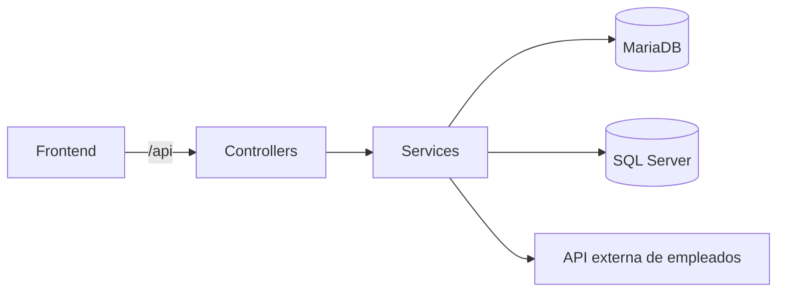

# Documentación Técnica – Backend

API REST que calcula y expone el desempeño de los operadores, autentica usuarios y recibe cargas de datos desde Excel.

## 1. Stack

| Tecnología | Uso |
| --- | --- |
| NestJS 11 + TypeScript | Framework |
| TypeORM | Acceso a datos |
| MariaDB (`mysql2`) | Base principal (conexión por defecto) |
| SQL Server (`mssql`) | Datos de nómina/empleados (conexión `sqlserver`) |
| bcrypt | Hash de contraseñas |
| xlsx + Multer | Lectura de archivos Excel subidos |
| Jest | Pruebas |

Dependencias de `@nestjs/jwt` y `passport-jwt` están instaladas, pero el login actual **no emite un JWT real** (ver sección 5).

## 2. Arquitectura



Cada módulo sigue el patrón **Controller → Service → Entity**.

```text
backend/src/
├── main.ts            # Prefijo /api, CORS, puerto
├── app.module.ts      # Conexiones a BD y módulos
├── autenticacion/     # Login, operadores, API de empleados
├── desempeno/         # Métricas, bonos, rankings
├── carga-datos/       # Importación de Excel
└── usuarios/          # CRUD de usuarios administrativos
```

## 3. Endpoints

Prefijo global: `/api`.

### Autenticación (`/autenticacion`)

| Método | Ruta | Descripción |
| --- | --- | --- |
| POST | `/login` | Valida credenciales y devuelve datos del usuario |
| GET | `/operadores` | Lista de operadores |
| PUT | `/operadores/:codigo` | Actualiza zona/padrino de un operador |

### Desempeño (`/desempeno`)

| Método | Ruta | Descripción |
| --- | --- | --- |
| GET | `/periodos` | Años y meses con datos |
| GET | `/ranking?anio=&mes=` | Ranking general de operadores |
| GET | `/cedula/:cedula` | Desempeño buscando por cédula |
| GET | `/:codigo/anios` | Años con datos de un operador |
| GET | `/:codigo?anio=` | Métricas anuales y mensuales de un operador |

### Carga de datos (`/carga-datos`)

Reciben un archivo Excel (`multipart/form-data`).

| Método | Ruta | Descripción |
| --- | --- | --- |
| POST | `/kilometros` | Importa kilómetros programados y ejecutados |
| POST | `/novedades` | Importa novedades |
| POST | `/operadores` | Importa operadores |

### Usuarios (`/usuarios`)

CRUD: `GET /`, `GET /:id`, `POST /`, `PUT /:id`, `DELETE /:id`.

## 4. Modelo de datos

| Entidad | Tabla | Campos principales |
| --- | --- | --- |
| `Usuario` | `usuarios` | id, nombre, codigo (único), clave (hash), permisos (JSON), activo, fecha_creacion, ultimo_acceso |
| `Operador` | `operadores` | id, codigo, zona, padrino |
| `VariableControl` | `variables_control` | codigoEmpleado, codigoVariable (`KM`/`KMS`), valorProgramacion, valorEjecucion, fechas de programación y ejecución |
| `VariableControlPrueba` | `variables_control_prueba` | Misma estructura; destino de las cargas de Excel |
| `Novedad` | `novedades` | codigoEmpleado, codigoFactor, fechaInicioNovedad, fechaFinNovedad, observaciones |

`synchronize: false`: el esquema se administra manualmente.

SQL Server se consulta (solo lectura) en la tabla `SE_W0550` para obtener nombre, cargo y fechas de ingreso/retiro del empleado.

## 5. Autenticación

`POST /autenticacion/login` recibe `{ codigo, clave }` y sigue este orden:

1. **Administrador**: busca en `usuarios` (activo) y compara la clave con `bcrypt`. Devuelve rol `admin` y permisos.
2. **Operador**: si no es admin, formatea el código a 4 dígitos, lo busca en la API externa de empleados y valida que la **cédula** coincida con la `clave`.
3. Enriquece con SQL Server (nombre, cargo, fechas) y busca la foto del empleado (`jpg`, `jpeg`, `png`) en el servidor de administración.

> [!WARNING]
>
> - El `access_token` de administrador es un texto fijo (`jwt-admin-simulado`); no hay JWT real ni guards activos en los endpoints.
> - Se define `NODE_TLS_REJECT_UNAUTHORIZED = '0'` durante la validación de la foto, lo que desactiva la verificación TLS del proceso.
> - La autorización real depende solo del middleware del frontend.

## 6. Reglas de negocio del desempeño

Implementadas en `desempeno.service.ts`.

**Kilómetros**: se suman `valor_programacion` y `valor_ejecucion` de las variables `KM`/`KMS` por empleado y mes. El cumplimiento es ejecutado / programado.

**Bono**: parte de un valor base según **año y cargo** (`getBaseBonusForYearAndRole`). Cada novedad del mes descuenta un porcentaje del bono según el código de factor:

| Factor | Descuento |
| --- | --- |
| Incapacidad, retardo, daño leve, desincentivo leve, falta menor, hábitos leves | 25 % |
| Retardo por horas, daño grave, desincentivo grave, falta media, hábitos graves | 50 % |
| Reglas por día | (base / 30) × días |

- Solo las reglas con `afectaDesempeno` reducen el porcentaje de cumplimiento; las demás solo reducen el valor monetario.
- Un mes sin registros de novedades cuenta como 0 % y no entra en el promedio.
- **Operador 1.5 SMLV**: el valor monetario del bono es 0, pero la eficiencia se calcula con la base del operador normal.
- Hay cargos con excepción por cédula (*Operador Reubicado*, *1.5 SMLV*).

**Eficiencia global**: promedio entre el cumplimiento de KM y el de BONO; si solo hay uno de los dos, se usa ese.

**Ranking** (`obtenerRankingGeneral`): consulta kilómetros por mes (con filtro opcional de año y mes), obtiene los cargos desde SQL Server en lotes de 1000 y calcula los bonos por empleado.

## 7. Carga de datos desde Excel

1. Se lee el archivo con `xlsx`; los encabezados aceptan varias variantes (con o sin tilde, como `KM` o `VALOR EJECUCION`).
2. Se validan código de empleado y fechas; las filas inválidas se devuelven en `errores`.
3. Se descartan **duplicados** (empleado + variable + fecha inicio + fecha fin), tanto dentro del archivo como en la base de datos.
4. Se guardan los nuevos registros en lote.
5. La respuesta incluye conteos de procesados, duplicados y errores.

## 8. Variables de entorno (`backend/.env`)

| Variable | Descripción |
| --- | --- |
| `PORT` | Puerto (3001 por defecto; 3040 en producción) |
| `DB_HOST`, `DB_USER`, `DB_PASSWORD`, `DB_NAME` | MariaDB |
| `SQLSERVER_HOST`, `SQLSERVER_USER`, `SQLSERVER_PASSWORD`, `SQLSERVER_DATABASE` | SQL Server |
| `DB_CM_*` | Base de programación (conexión comentada) |

El workflow genera este archivo desde los *secrets* de GitHub.

## 9. Comandos

```bash
cd backend
pnpm install
pnpm start:dev    # desarrollo con watch
pnpm build
pnpm start:prod   # node dist/main
pnpm test
```

Más sobre pruebas en [TESTING.md](../backend/TESTING.md).

## 10. Despliegue

Mismo workflow de GitHub Actions que el frontend: escribe el `.env`, compila y reinicia con **PM2** (`indicador-desempeno-backend`, ejecuta `pnpm run start:prod`).

## 11. Puntos de mejora

- Implementar JWT real y guards en los endpoints protegidos.
- Quitar `NODE_TLS_REJECT_UNAUTHORIZED = '0'`.
- Restringir CORS (hoy `origin: true`) y mover los puertos de BD a variables de entorno.
- Crear el endpoint `/mantenimiento/ranking`, que el frontend ya usa.
- Mover reglas de deducción, bonos y cargos especiales a la base de datos.
- Dividir `desempeno.service.ts` (cálculo de bono, kilómetros y ranking) en servicios más pequeños.
