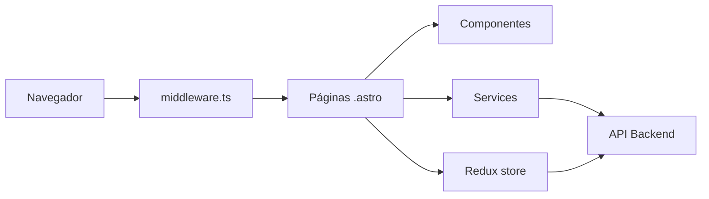

# Documentación Técnica – Frontend

Aplicación web para consultar el **indicador de desempeño** de los operadores: kilómetros, novedades, bonos y mantenimiento. Tiene dos perfiles: **operador** (ve su propio desempeño) y **administrador** (rankings, carga de datos y usuarios).

## 1. Stack

| Tecnología | Uso |
|---|---|
| Astro 6 (`output: 'server'`) | Framework, páginas y componentes |
| `@astrojs/node` (standalone) | Servidor SSR, puerto **3039** |
| Redux Toolkit | Estado global del desempeño |
| Chart.js | Gráficas |
| TypeScript | Tipado |
| pnpm | Gestor de paquetes |

## 2. Arquitectura



- **Páginas** (`pages/`): una por ruta; cargan datos desde scripts del cliente.
- **Componentes**: piezas reutilizables, agrupadas por dominio.
- **Services**: lógica de filtros y bonos fuera de las vistas.
- **Store**: estado compartido del dashboard del operador.

## 3. Estructura

```text
src/
├── components/
│   ├── admin/        # DataUploadCard (carga de archivos)
│   ├── layout/       # Sidebar (admin) y OperatorSidebar
│   ├── operadores/   # Dashboard de desempeño
│   ├── rankings/     # Tarjetas, filtros y modales con tabs
│   ├── icons/ ui/    # Icon, Tabs, HeaderCard, BonoChartModal
├── config/api.ts     # URL base y endpoints
├── layouts/          # AdminLayout, OperatorLayout
├── middleware.ts     # Protección de rutas
├── pages/            # Rutas
├── services/         # BonoService, FiltroService
├── store/            # Redux
└── styles/           # Estilos globales
```

**Alias de importación** (`tsconfig.json`): `@components`, `@layouts`, `@services`, `@config`, `@styles`, `@store`.

## 4. Rutas

| Ruta | Acceso | Descripción |
|---|---|---|
| `/` y `/login` | Público | Inicio de sesión |
| `/operadores/desempeno` | Autenticado | Dashboard del operador |
| `/admin/rankings/operadores` | Admin | Ranking por categoría (Oro, Plata, Bronce, Mejorar, Taller Conciencia) |
| `/admin/rankings/bono` | Admin | Ranking de bonos |
| `/admin/rankings/mantenimiento` | Admin | Ranking de mantenimiento |
| `/admin/cargar-datos/kilometros` | Admin | Subida de Excel de kilómetros |
| `/admin/cargar-datos/novedades` | Admin | Subida de Excel de novedades |
| `/admin/usuarios` | Admin | Gestión de usuarios |
| `/admin/detalle-usuarios` | Admin | Detalle de usuarios |

## 5. Autenticación y sesión

1. En `/login` el usuario ingresa **código** y **contraseña** (para operadores, la contraseña es su cédula).
2. Se llama a `POST /autenticacion/login`.
3. La respuesta (`access_token` y `usuario`) se guarda en `localStorage` (`user_token`, `user_data`) y en cookies (`auth_token`, `auth_usuario`, `SameSite=Strict`).
4. Se redirige según el rol: administradores a `/admin/rankings/operadores`, operadores a su dashboard.

**Middleware** (`src/middleware.ts`), en cada petición:

- Deja pasar rutas públicas (`/login`, `/`) y archivos estáticos.
- Sin cookies de sesión: redirige a `/login?razon=sesion_requerida`.
- Cookie corrupta: la borra y redirige con `sesion_invalida`.
- Rutas `/admin/*`: solo si `rol === 'admin'` o el código está en la lista `USUARIOS_ADMIN`; si no, `sin_permisos`.

> [!WARNING]
> La sesión se basa en una cookie con datos del usuario en JSON, sin firma. Además, `login.astro` contiene un acceso con datos *mock* para administradores. Ambos puntos deben revisarse antes de endurecer la seguridad.

## 6. Estado global (Redux)

Store con un slice, `desempeno`:

| Estado | Descripción |
|---|---|
| `operatorCode` | Código del operador activo |
| `selectedYear` | Año seleccionado (por defecto el actual) |
| `availableYears` | Años con datos |
| `performanceData` | Datos del año seleccionado |
| `historicalData` | Mapa año → datos |
| `loading` / `error` | Estado de la petición |

Thunks: `fetchPerformanceData`, `fetchAvailableYears` y `fetchHistoricalData` (consulta varios años en paralelo). Reducers: `setOperatorCode`, `setSelectedYear`, `clearDesempenoData`.

## 7. Services

| Service | Métodos | Función |
|---|---|---|
| `FiltroService` | `obtenerDeUrl`, `sincronizarUrl`, `obtenerPredeterminados` | Mantiene los filtros (año, mes, etc.) sincronizados con la URL |
| `BonoService` | `obtenerOperadoresConBono`, `filtrarOperadores`, `calcularEstadisticas` | Arma la lista de operadores con su bono, filtra y cuenta por rango |

`BonoService` incluye un listado fijo de cédulas con cargo especial (*Operador Reubicado*, *Operador 1.5 SMLV*).

## 8. Consumo de la API

Centralizado en `src/config/api.ts`:

```ts
API_CONFIG.BASE_URL        // URL del backend
getApiUrl('/desempeno/ranking')
```

| Constante | Endpoint |
|---|---|
| `LOGIN` | `/autenticacion/login` |
| `OPERADORES.GET_ALL` | `/autenticacion/operadores` |
| `DESEMPENO.GET_METRICS` | `/desempeno/:codigo?anio=` |
| `DESEMPENO.GET_YEARS` | `/desempeno/:codigo/anios` |
| `DESEMPENO.GET_RANKING` | `/desempeno/ranking` |
| `DESEMPENO.GET_PERIODOS` | `/desempeno/periodos` |
| `MANTENIMIENTO.GET_RANKING` | `/mantenimiento/ranking` |

> [!NOTE]
> `BASE_URL` apunta a producción; para local cambiar a `http://localhost:3040/api` (hay una línea comentada). Lo ideal es moverla a una variable de entorno.

## 9. Componentes principales

- **Rankings**: `OperatorCard`, `MaintenanceCard`, `SearchFilters`, `ModalFiltros`. La lista usa *scroll infinito* (20 elementos por carga).
- **Modal de detalle de operador**: tabs `TabGeneral`, `TabKilometros`, `TabBonos`; modales de novedades y bono mensual. Apoyo en `modal/charts`, `modal/dom` y `modal/utils`.
- **Dashboard del operador**: `WelcomeHeader`, `MetricStats`, `StatCard`, `MonthlyGrid`, `AnnualYearsSummary`, `ChartWrapper`.
- **UI general**: `Icon`, `Tabs`, `HeaderCard`, `BonoChartModal`.

## 10. Flujo típico (ranking)

1. La página carga filtros desde la URL (`FiltroService`).
2. Pide `/desempeno/ranking` y la lista de operadores.
3. Combina datos, filtra por categoría y búsqueda.
4. Pinta tarjetas con scroll infinito; al abrir una, se muestra el modal con gráficas.

## 11. Comandos

```bash
pnpm install
pnpm dev       # http://localhost:3039
pnpm build     # genera dist/
pnpm preview
```

## 12. Despliegue

GitHub Actions (`.github/workflows/deploy.yml`) en cada push a `main`: copia el código al servidor, instala, compila y reinicia con **PM2** (`indicador-desempeno-frontend`, ejecuta `dist/server/entry.mjs`).

## 13. Diseño

Ver [README-DESING.md](../README-DESING.md): estilo minimalista, sombras suaves, bordes redondeados y transiciones de ~0.25s.

## 14. Puntos de mejora

- `/mantenimiento/ranking` no existe en el backend actual.
- Sustituir `any` por interfaces tipadas (por ejemplo, en el slice).
- Mover los cargos especiales fijos a la base de datos.
- Sesión firmada (JWT real) en lugar de cookie con JSON.
